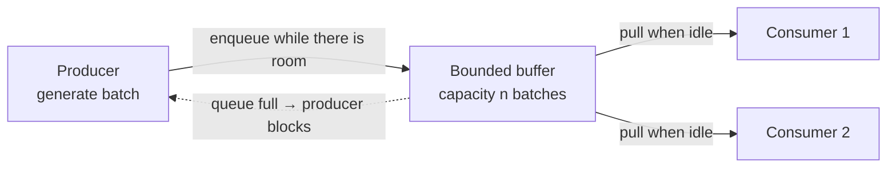

# Bounded buffer between one producer and M consumers

## Document info

| Item | Detail |
| --- | --- |
| Level | High level (model, behaviour contract, sizing); no coding details |
| Runtime | Standalone service, thread pool or process pool |
| Shape | 1 producer → bounded FIFO buffer → M consumers |
| Out of scope | Batch content and payload schema, downstream storage, deployment topology |

## 1. Problem

A single producer generates work in batches. M consumers process those batches in parallel. Processing is much slower than generation, so without a limit the producer would run ahead and accumulate work faster than it can ever be consumed — memory grows, latency grows, and a failure means redoing a large amount of stale work.

The requirement is therefore a **WIP limit**: the producer may only stay ahead by a fixed number of batches, and must not be able to exceed it by any means.

## 2. Model



Three roles:

| Role | Count | Responsibility |
| --- | --- | --- |
| Producer | 1 | Generate batches and enqueue them; block when the buffer is full |
| Buffer | 1 | FIFO queue with a hard capacity of `n` batches |
| Consumer | M | Pull one batch when idle, process it, then come back for the next |

Three rules define the whole behaviour:

1. **The producer may enqueue only while `queued < n`.** Otherwise it blocks — it does not drop, and it does not spin.
2. **A consumer pulls only when idle.** It never holds two batches, and it never receives a batch while still working on one.
3. **Capacity counts queued batches only.** The batch currently being processed sits outside the buffer, so one batch per consumer is always in flight on top of `n`:

> Total work in the system ≤ `n` queued + `M` in flight

### The consequence worth stating explicitly

**The producer never asks whether a consumer is available.** Because availability means "idle" and consumers pull, availability is expressed *only* through the buffer's fill level. There is no health check, no idle registry, no scheduling decision.

This is a deliberate simplification: adding a "tell me which consumers are free" channel would introduce a second source of truth that can disagree with the queue, and every such disagreement is a deadlock or a double-dispatch. The queue is the only state that matters.

## 3. Behaviour contract

| Situation | Required behaviour |
| --- | --- |
| Buffer not full, producer has a batch | Enqueue immediately |
| Buffer full | Producer blocks until a slot frees |
| Consumer idle, buffer non-empty | Takes exactly one batch |
| Consumer idle, buffer empty | Blocks waiting for a batch |
| Batch processing finishes | Consumer becomes idle and immediately tries to pull again |
| Batch processing fails | See §6 — do not silently drop |
| Shutdown requested | Stop producing, drain, then stop consumers |

## 4. Implementation

### 4.1 The default choice: a bounded blocking queue

A `queue.Queue(maxsize=n)` in a thread-pool service already gives exactly this contract: `put()` blocks when full, `get()` blocks when empty, FIFO order, thread-safe. No custom synchronisation is needed.

### 4.2 The trap that silently disables the whole design

`ThreadPoolExecutor.submit()` **never blocks**. Its internal work queue is unbounded. A producer that submits in a loop will run to completion regardless of how slow the consumers are — the WIP limit exists on paper but not in memory, which is worse than having none, because the design looks correct.

If the service is built around an executor, the limit must be enforced *before* submission:

```python
slots = threading.BoundedSemaphore(n)

slots.acquire()            # producer blocks here — this is the real WIP limit
future = pool.submit(work, batch)
future.add_done_callback(lambda _: slots.release())
```

Rule of thumb: **the semaphore, not the executor, is the buffer.** Either this, or use `queue.Queue` directly with long-lived worker threads and skip the executor.

### 4.3 Process pool

`multiprocessing.Queue(maxsize=n)` bounds the pipe, and `put()` blocks when the bound is reached. Two caveats:

- **The bound is approximate.** Values are counted by the feeder thread, and `qsize()` is unreliable by design. Do not build logic that requires an exact instantaneous count.
- **Objects are pickled.** Batch size therefore affects memory twice (in the producer and in the pipe buffer). Keep batches small enough that `n` of them is comfortable.

### 4.4 Batching and pull granularity

The consumer should pull **one batch per pull**, and the batch should be sized so that `T_process` is neither so small that queue overhead dominates nor so large that a single batch blocks a consumer for minutes. `T_process` in the tens-of-seconds range is the usual sweet spot for compute-heavy batches.

## 5. Sizing

Throughput is bounded by the consumers, not by the producer:

> steady-state throughput ≤ `M / T_process` batches per second

The buffer does not increase throughput. It only absorbs **arrival variance** so that a bursty producer does not stall, and so that consumers are never starved between batches. Sizing follows from the worst burst:

> `n ≈ burst_arrivals − (burst_duration × M / T_process)`

| `n` | Effect |
| --- | --- |
| `0` | Degenerates into hand-off; producer and a consumer must rendezvous per batch. Rarely what you want. |
| `1` | Nearly serialised. The producer must be scheduled promptly after every consume, so any scheduling delay directly limits throughput. |
| `M` | Reasonable default — each consumer has one batch queued ahead, so a consumer never waits on the producer. |
| `≫ M` | Smooths large bursts, but hides consumer slowness behind a long queue and increases the work lost on restart. |

Start at `n = M`, measure the blocked time of the producer, and raise only if the producer is stalling on variance rather than on genuine capacity.

## 6. Failure and shutdown

| Case | Handling |
| --- | --- |
| Consumer raises while processing | Batch is not acknowledged. Retry up to `k` times, then quarantine it to a dead-letter list. Retrying in place risks blocking that consumer forever. |
| Consumer process is killed | The in-flight batch is lost. Acceptable only if batches are regenerable; otherwise the batch must be recorded as in-progress before processing starts. |
| All consumers die | **The producer fills `n` slots and blocks permanently.** This is the main hazard of the blocking design — see §10. |
| Producer finishes | Enqueue one sentinel per consumer; consumers exit on sentinel, so a sentinel is never mistaken for a batch. |
| Shutdown signal | Stop the producer first, then let the queue drain, then send sentinels, then join with a timeout. Sending sentinels early drops queued work. |

## 7. Observability

Three signals are sufficient to tell whether the design is working:

| Metric | Why |
| --- | --- |
| Queue depth (`queued / n`) | Distinguishes "buffer too small" (always full) from "too large" (always deep) |
| Producer blocked time per batch | The direct measure of backpressure. Near zero means `n` is oversized. |
| Consumer idle time | Near zero means consumers are the bottleneck and no buffer will help |

## 8. Requirements

| ID | Capability |
| --- | --- |
| R1 | Hard capacity of `n` queued batches; exceeding it blocks the producer, never drops |
| R2 | Consumers pull one batch at a time and only when idle |
| R3 | Graceful shutdown drains queued batches without loss |
| R4 | A failing batch is retried a bounded number of times and then quarantined |
| R5 | Queue depth, producer blocked time and consumer idle time are observable |
| R6 | Blocking never becomes permanent: a stall must raise an alert rather than hang silently |

## 9. Assumptions

| ID | Assumption | Impact if invalid |
| --- | --- | --- |
| A1 | `n` counts queued batches only; in-flight batches are extra | If `n` is meant as total WIP, the effective queue capacity is `n − M` and can reach zero |
| A2 | M is fixed for the lifetime of the service | Dynamic M with a fixed `n` changes the per-consumer share of the buffer |
| A3 | Batches are independent; completion order does not matter | Ordering would force `n = 1` or a sequencing layer |
| A4 | Exactly one producer | Multiple producers would need a shared semaphore, and the capacity becomes global rather than per-producer |
| A5 | A lost in-flight batch is regenerable | Otherwise in-progress state must be persisted before processing |

## 10. Risks

| Risk | Description | Mitigation |
| --- | --- | --- |
| Permanent stall | Consumers all dead → queue fills to `n` → producer blocks forever, with no error | Watchdog on consumer liveness; producer block timeout that alerts instead of waiting silently |
| Limit silently absent | Executor-based implementation with an unbounded submission queue; the design holds on paper only | Enforce the limit with a semaphore acquired before submission (§4.2) |
| Buffer too large | Hides consumer slowness behind a deep queue and increases work lost on restart | Size from burst measurement, not from intuition; watch producer blocked time |
| Retry storm | A poison batch retried forever by the same consumer | Bounded retries plus dead-letter quarantine |

## 11. Open questions

| Question | Impact |
| --- | --- |
| Concrete value of `n` and `M` | Sizing; needs the real `T_process` and burst profile |
| Should `n` be total WIP rather than queued-only? | Changes the effective capacity to `n − M` (see A1) |
| At-most-once or at-least-once? | At-least-once requires idempotent batch processing and a requeue path |
| Must queued work survive a restart? | In-memory queue loses it; a persistent queue changes the implementation entirely |

## Change log

| Date | Change | Author |
| --- | --- | --- |
| 2026-11-03 | Initial draft: model, behaviour contract, sizing, failure handling | — |
