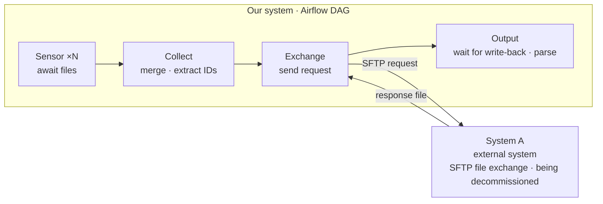
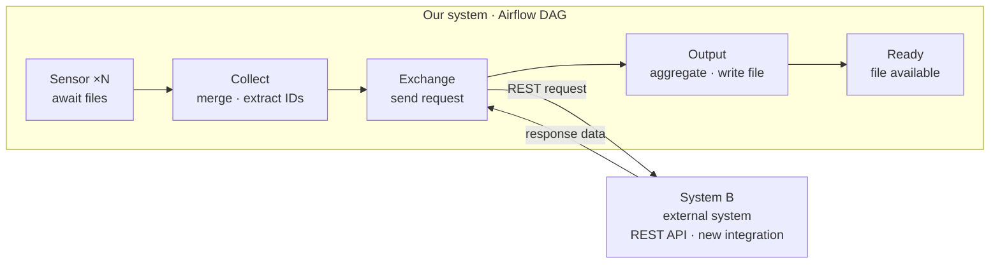
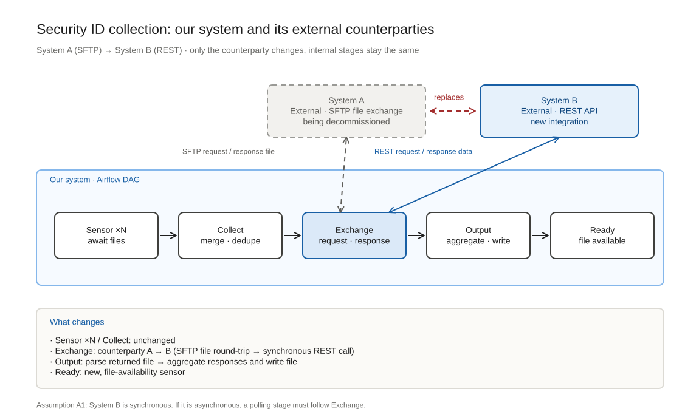

# Security ID collection — internal switch from System A to System B

## Document info

| Item | Detail |
| --- | --- |
| Level | High level (requirements + DAG shape); no interface contract |
| Orchestration | Apache Airflow |
| Subject of change | The segment of the DAG that talks to an external data source |
| Out of scope | Interface fields, error codes, rate-limit parameters, upstream collection logic, downstream consumption |

## 1. Background

Upstream systems deliver Security ID lists as files, and Airflow uses Sensors to detect their arrival. After the lists are merged, the current DAG **generates a request file, pushes it to System A over SFTP, waits for a response file to be written back, and then parses it**.

System A is being retired. Its replacement, System B, **exposes a REST API only**.

## 2. Goal

> Replace the DAG segment "generate file → SFTP → wait for file → parse" with a single stage that calls System B directly.

Acceptance criteria:

1. Upstream Sensors and the shape of the final output file are unchanged.
2. A single run is directly comparable to a run before the switch, with identical results.
3. Once System A is decommissioned, all requests are served by System B alone.

## 3. Scope

| In scope | Out of scope |
| --- | --- |
| Replacing the exchange stage | Interface fields, error codes, rate-limit parameters |
| Batching and concurrency | Upstream Sensor changes |
| Run-level traceability | Downstream consumption, platform deployment |

## 4. Current state (AS-IS)

Merged into four stages by phase (in practice, generating the file, waiting for write-back and parsing are three separate tasks; they are merged here so the two rows line up). System A sits outside our system and relates to it as request → response:

**The existence of the file is itself the success signal** — the asset most easily lost in this migration.

## 5. Target state (TO-BE)

The same four stages, with System B as the external counterparty, plus one extra Sensor at the end:

The skeleton is identical to the current state. **The change happens inside a single stage**, which is a deliberate design goal.

## 6. Change comparison

System A and System B are both independent systems outside our own, and both interactions follow the same **request → response** shape. The switch only swaps the counterparty; it does not alter the stage structure of our system:

> Editable source: [`diagrams/2026-11-03-interaction-structure.excalidraw`](diagrams/2026-11-03-interaction-structure.excalidraw). Open the source in Excalidraw to edit, and **re-export the SVG under the same name afterwards** — otherwise the document keeps showing the old figure.

| Stage | Current | Target | Change |
| --- | --- | --- | --- |
| Sensor ×N | Await upstream files | Same | Unchanged |
| Collect | Merge · extract IDs | Same | Unchanged |
| **Exchange** | SFTP request to **System A**, wait for a file to be written back | REST request to **System B**, receive a synchronous response | **Counterparty replaced — the core of this change** |
| Output | Parse the returned file and persist | Aggregate responses · write file | Rewritten internally, identical externally |
| Ready | — | File-availability Sensor | New |

## 7. Implementation notes

| Concern | Approach | Rationale |
| --- | --- | --- |
| No adapter layer for A | Delete the SFTP branch; implement the B client only | A is decommissioned once and for all; an abstraction would only serve the transition, and with no parallel run it becomes dead code on cutover day |
| Batch concurrency | Dynamic task mapping (`expand`) | Each batch gets its own retries and state, restoring the "whole batch visible" property of the file era |
| Passing the ID list | Persist to disk; pass only the path via XCom | Tens of thousands of IDs in XCom would strain the metadata database |
| Retries | Overwrite results per batch key | `retries` re-executes the task, so writes must be idempotent |
| Sensor shape | `mode="reschedule"` + `timeout` | Long waits must not hold a worker slot |
| Partial failure | Emit a missing-ID list on callback | REST has no natural "file landed" signal |

## 8. Requirements

| ID | Capability |
| --- | --- |
| R1 | Merge and dedupe lists from multiple upstreams into the input of a single run |
| R2 | Split the list into batches and call System B concurrently |
| R3 | Aggregate responses into the complete result of a run and write the target file |
| R4 | Make every run traceable: batch states, success counts, missing IDs |

## 9. Assumptions

| ID | Assumption | Impact if invalid |
| --- | --- | --- |
| A1 | System B is a **synchronous** API | If asynchronous, a polling stage must follow Exchange — one more stage |
| A2 | Airflow ≥ 2.4, with task mapping support | Degenerates to a loop inside one task, losing per-batch retries |
| A3 | A single run stays within tens of thousands of IDs | Affects batch sizing and concurrency limits |
| A4 | One-off hard cutover, no parallel run | A parallel run is the only justification for an A/B dual implementation |

## 10. Risks

| Risk | Description | Mitigation |
| --- | --- | --- |
| Loss of atomicity | "Whole batch visible" disappears in the API era | Batch mapping + missing-ID list |
| Misread semantics | "Not found" is a business outcome, not a failure | Separate business gaps from retryable faults |
| No way back | No rollback once A is decommissioned | Complete consistency validation before cutover |

## Change log

| Date | Change | Author |
| --- | --- | --- |
| 2026-11-03 | Initial draft: high-level requirements and AS-IS / TO-BE | — |
| 2026-11-03 | Recast around Airflow: component view, DAG view, implementation notes | — |
| 2026-11-03 | Added A→B change comparison aligned column by column | — |
| 2026-11-03 | Simplified: figures 4→3, tasks 7→5; no adapter layer for A | — |
| 2026-11-03 | Promoted System A / B to standalone nodes outside the system boundary; interactions as request-response arrows | — |
| 2026-11-03 | Added Excalidraw version of the interaction figure (source + SVG export) | — |
| 2026-11-03 | Translated the document and figure to English; file names switched to ASCII | — |
