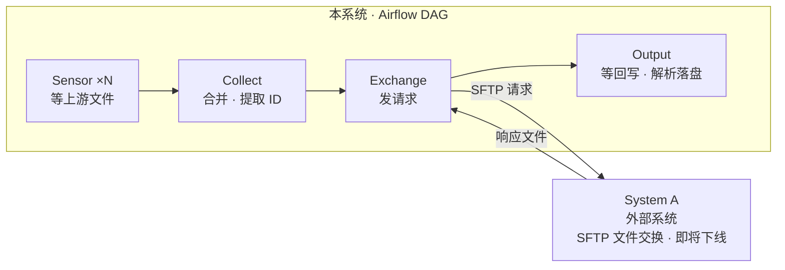
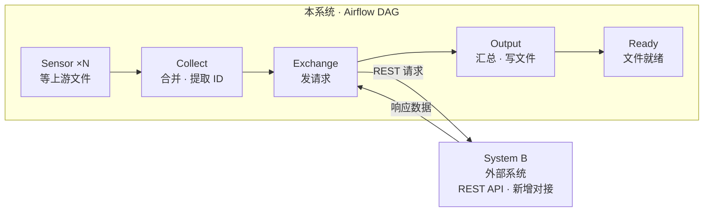

# Security ID 采集链路：System A → System B 内部切换

## 文档信息

| 项 | 内容 |
| --- | --- |
| 层级 | 高层（需求 + DAG 形态），不含接口契约 |
| 编排平台 | Apache Airflow |
| 变更主体 | DAG 中与外部数据源交互的那一段 |
| 不在本文档内 | 接口字段、错误码、限流参数、上游采集逻辑、下游消费 |

## 1. 背景

上游多家系统以文件形式交付 Security ID 清单，Airflow 用 Sensor 感知文件到达。合并取数后，当前 DAG **生成请求文件、经 SFTP 推给 System A、等响应文件回写、再解析**。

System A 即将退役，替代者 System B **只提供 REST API**。

## 2. 目标

> 把 DAG 中「生成文件 → SFTP → 等文件 → 解析」这一段，换成一个直接调用 System B 的环节。

验收三条：

1. 上游 Sensor 与最终产出文件的形态不变。
2. 单次运行产出与切换前可对比，结果一致。
3. System A 下线后，全量请求仅依赖 System B 完成。

## 3. 范围

| 在范围内 | 不在范围内 |
| --- | --- |
| 交换环节的替换 | 接口字段、错误码、限流参数 |
| 批次切分与并发 | 上游 Sensor 改造 |
| 单次运行的结果追溯 | 下游消费、平台部署 |

## 4. 现状

按**阶段**归并后是四个环节（实现上更细，生成文件 / 等待回写 / 解析是三个独立 task，这里合并以便对照）。System A 在本系统之外，与本系统是请求-响应关系：

**文件的存在本身就是成功信号**——这是后面最容易丢掉的资产。

## 5. 目标

同样是四个环节，外部交互对象换成 System B，末尾多一个 Sensor：

骨架和现状一致。**变化只发生在一个环节内部**，这是刻意的设计目标。

## 6. 变更对照

System A 与 System B 都是本系统之外的独立系统，交互方式统一为**请求 → 响应**的双向箭头。切换只更换交互对象，不改变本系统的环节结构：

| 环节 | 现状 | 目标 | 变化 |
| --- | --- | --- | --- |
| Sensor ×N | 等上游文件 | 同左 | 不变 |
| Collect | 合并 · 提取 ID | 同左 | 不变 |
| **Exchange** | 向 **System A** 发 SFTP 请求，等文件回写 | 向 **System B** 发 REST 请求，拿同步响应 | **外部对象替换，本次核心** |
| Output | 解析回写文件落盘 | 汇总响应 · 写文件 | 内部改写，对外一致 |
| Ready | — | 文件就绪 Sensor | 新增 |

## 7. 实现要点

| 关注点 | 做法 | 原因 |
| --- | --- | --- |
| 不为 A 保留适配层 | 直接删掉 SFTP 分支，只写 B 的 client | A 是一次性下线，抽象一层只为过渡期服务；无并行期就是多余 |
| 批次并发 | dynamic task mapping（`expand`） | 每批独立重试与状态，替代文件时代的「整批可见」 |
| ID 清单传递 | 落盘，XCom 只传路径 | 万级 ID 塞 XCom 会撑爆元数据库 |
| 失败重跑 | 每批结果按 batch key 覆盖写 | `retries` 会重跑任务，必须幂等 |
| Sensor 形态 | `mode="reschedule"` + `timeout` | 长等待不占 worker slot |
| 部分失败 | 回调产出缺失清单 | REST 没有文件落地的天然信号 |

## 8. 需求

| 编号 | 能力 |
| --- | --- |
| R1 | 多上游清单合并、去重，形成一次运行的输入 |
| R2 | 清单分批、并发调用 System B |
| R3 | 响应汇总为一次运行的完整结果并写出目标文件 |
| R4 | 每次运行可追溯：批次状态、成功数、缺失 ID |

## 9. 假设

| 编号 | 假设 | 不成立的影响 |
| --- | --- | --- |
| A1 | System B 为**同步**接口 | 异步则需在 Exchange 之后插入轮询，多一个环节 |
| A2 | Airflow ≥ 2.4，支持 task mapping | 退化为单任务内循环，失去批次级重试 |
| A3 | 单次运行 ID 在万级以内 | 影响批次切分与并发上限 |
| A4 | 一次性硬切换，无并行期 | 若有并行期，才值得做 A/B 双实现 |

## 10. 风险

| 风险 | 说明 | 缓解 |
| --- | --- | --- |
| 原子性丢失 | 「整批可见」在 API 时代消失 | 批次映射 + 缺失清单 |
| 语义误判 | 「查不到」是业务结果不是故障 | 区分业务缺失与可重试故障 |
| 无退路 | A 下线后不可回滚 | 切换前完成一致性验证 |

## 变更记录

| 日期 | 变更 | 作者 |
| --- | --- | --- |
| 2026-11-03 | 初稿：高层需求与 AS-IS / TO-BE | — |
| 2026-11-03 | 按 Airflow 落地：组件视图、DAG 视图与实现要点 | — |
| 2026-11-03 | 补充 A→B 变更对照：两行按列对齐 | — |
| 2026-11-03 | 简化：图 4→3 张，任务 7→5 个；明确不为 A 保留适配层 | — |
| 2026-11-03 | System A / B 提升为边界外的独立节点，交互改为请求-响应双向箭头 | — |
