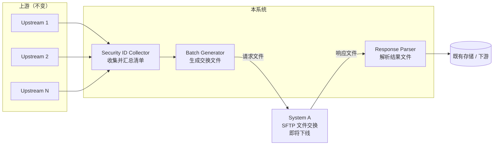
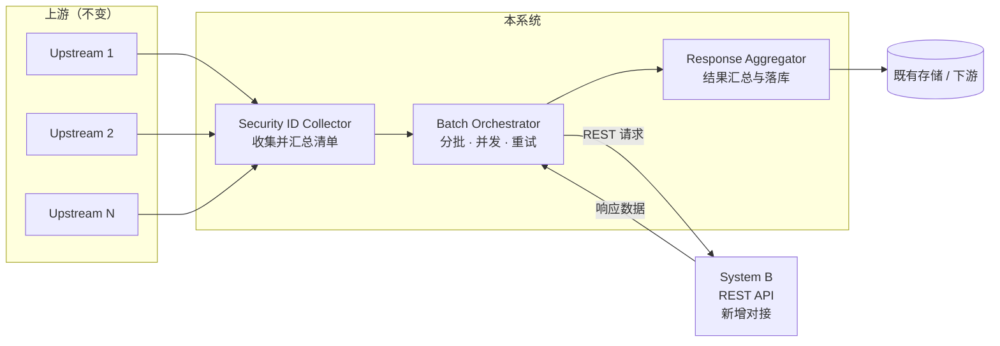

# Security ID 采集链路：System A → System B 内部切换

## 文档信息

| 项 | 内容 |
| --- | --- |
| 层级 | 高层（需求 + 上下文架构），不含接口契约 |
| 变更主体 | 本系统与外部数据源之间的交互方式 |
| 不在本文档内 | 接口字段与映射、错误码定义、限流与退避参数、上游采集改造、下游消费改造 |

## 1. 背景

本系统从多个上游系统收集 Security ID 清单，汇总后提交给外部系统处理，再取回结果用于后续流程。

当前与 System A 之间采用 **SFTP 文件交换**：本系统生成请求文件上传，System A 处理后回写响应文件。

System A 即将退役，替代者 System B **只提供 REST API**，不再有文件通道。

## 2. 目标

> 在不改变上游采集与下游消费的前提下，把本系统与外部数据源的交互，从「SFTP 文件交换（System A）」切换为「REST API（System B）」。

可验收的三点：

1. 上游与下游均无改动 —— 变化被限制在本系统内部。
2. 单次运行的产出与切换前可对比，结果一致。
3. System A 下线后，全量请求仅依赖 System B 即可完成。

## 3. 范围

| 在范围内 | 不在范围内 |
| --- | --- |
| 与外部的交互适配（SFTP → REST） | 具体接口字段与数据映射 |
| 批次如何组织、如何取回结果 | 错误码枚举、超时与退避参数 |
| 单次运行的结果如何汇总与追溯 | 上游采集逻辑、下游消费模型 |
| 切换过程与验证方式 | 性能容量规划 |

## 4. 现状架构（AS-IS）

特征：**文件写完才可见**，一批数据天然构成一个原子快照；失败以「文件」为单位，重发即可。

## 5. 目标架构（TO-BE）

差异集中在两处：原来的「生成文件」被「批次编排」取代，原来的「解析文件」被「结果汇总」取代。上下游的位置和接口都没有动。

## 6. 关键变化

| 维度 | 现状（System A） | 目标（System B） | 带来的影响 |
| --- | --- | --- | --- |
| 交互方式 | SFTP 文件 | REST API | 需新增客户端与认证能力 |
| 批次语义 | 文件即一批，天然原子 | 逐条/批量请求，部分失败是常态 | 需在系统内重建「批次完整性」 |
| 失败单位 | 整个文件 | 单个请求 | 需区分可重试与业务性缺失 |
| 响应形态 | 定长文件 | 结构化响应 | 需解析与聚合 |
| 重跑成本 | 低（重发文件） | 高（需幂等） | 需定义幂等键 |
| 可观测性 | 文件落地即成功 | 无天然信号 | 需自建运行记录 |

## 7. 高层能力需求

| 编号 | 能力 | 说明 |
| --- | --- | --- |
| R1 | 清单汇总 | 从多个上游取 Security ID，合并去重后形成一次运行的输入 |
| R2 | 批次组织 | 将清单切分为可管理的批次，支持并发与限流控制 |
| R3 | 外部适配可替换 | 与外部系统的交互封装在独立适配层，A→B 切换不影响上下游 |
| R4 | 结果汇总 | 把分散的响应合并为一次运行的完整结果，并记录缺失项 |
| R5 | 失败可见 | 每次运行产出可追溯记录（成功数 / 失败数 / 缺失清单） |
| R6 | 可切换 | 在 A 下线前可验证一致性；下线后完成切换 |

## 8. 假设（待确认）

| 编号 | 假设 | 若不成立的影响 |
| --- | --- | --- |
| A1 | System B 支持批量或单条查询，具体粒度属实现细节 | 影响 R2 的批次切分与并发模型 |
| A2 | 各上游给出的 Security ID 类型一致 | 需新增归一化组件 |
| A3 | 单次运行 ID 规模在万级以内 | 影响批次划分与运行时长预期 |
| A4 | 一次性硬切换，无长期并行期 | 一致性问题只能在切换前暴露 |
| A5 | 业务上允许部分缺失，但缺失项必须可追查 | 需要整批原子提交机制（staging） |

## 9. 风险

| 风险 | 说明 | 缓解方向 |
| --- | --- | --- |
| 原子性丢失 | 文件时代的「整批可见」在 API 时代消失，部分失败不易察觉 | 批次运行记录 + 缺失清单 |
| 语义误判 | 「查不到」是正常业务结果，不是故障 | 明确区分业务性缺失与可重试故障 |
| 字段缺口 | 老响应文件的字段未被新接口覆盖 | 切换前做字段对照 |
| 无退路 | System A 下线后不可回滚 | 切换前完成一致性验证 |

## 变更记录

| 日期 | 变更 | 作者 |
| --- | --- | --- |
| 2026-11-03 | 初稿：高层需求与 AS-IS / TO-BE 上下文架构 | — |
