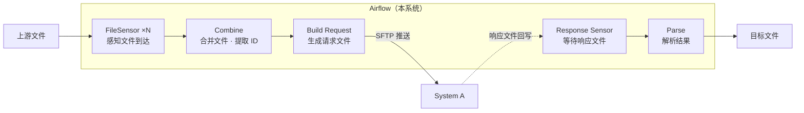
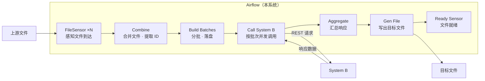
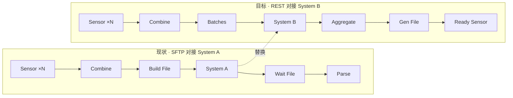

# Security ID 采集链路：System A → System B 内部切换

## 文档信息

| 项 | 内容 |
| --- | --- |
| 层级 | 高层（需求 + 上下文架构 + DAG 形态），不含接口契约 |
| 编排平台 | Apache Airflow |
| 变更主体 | 本系统与外部数据源之间的交互方式 |
| 不在本文档内 | 接口字段与映射、错误码定义、限流参数、上游采集逻辑、下游消费（下家不体现） |

## 1. 背景

上游有多家系统，各自以文件形式交付 Security ID 清单，由 Airflow 的 Sensor 感知文件到达。

当前 DAG 把文件合并、提取出 Security ID 清单后，**生成请求文件并通过 SFTP 推送给 System A**，再等待响应文件回写，解析后产出目标文件。

System A 即将退役，替代者 System B **只提供 REST API**，不再有文件通道。

## 2. 目标

> 在保持上游 Sensor 与产出文件不变的前提下，把 DAG 中「生成请求文件 → SFTP → 等待响应文件 → 解析」这一段，替换为「按 Security ID 清单调用 System B 的 REST API → 汇总响应 → 生成目标文件」。

可验收的三点：

1. 上游 Sensor 与最终产出文件的形态不变。
2. 单次运行的产出与切换前可对比，结果一致。
3. System A 下线后，全量请求仅依赖 System B 即可完成。

## 3. 范围

| 在范围内 | 不在范围内 |
| --- | --- |
| DAG 内 SFTP 相关任务的整体替换 | 具体接口字段、错误码、限流参数 |
| 批次如何切分、如何并发调用 | 上游 Sensor 的改造 |
| 单次运行的结果如何汇总与追溯 | 下游消费方（不体现） |
| 切换与验证方式 | Airflow 平台本身的部署 |

## 4. 现状（AS-IS）

### 4.1 组件视图

### 4.2 DAG 视图

两个 Sensor 定义了这条 DAG 的节奏：开头等上游文件，中间等 System A 回写。**文件的存在本身就是成功信号**——这也是后面变更中最容易丢掉的资产。

## 5. 目标（TO-BE）

### 5.1 组件视图

### 5.2 DAG 视图

变化集中在中间的三个任务：`Build Request File` 变为 `Build Batches`；原来指向 System A 的外部跳转，变为 `Call System B` 的并发任务组；`Wait Response` 与 `Parse` 合并为 `Aggregate`。**首尾两个 Sensor 保留不动。**

### 5.3 变更对照（A → B）

把两行按**同一列对齐**才能看出替换关系：第 4 列就是被换掉的那一格。

| 列 | 现状 | 目标 | 变化性质 |
| --- | --- | --- | --- |
| 1–2 | `Sensor ×N` → `Combine` | 同左 | 不变 |
| 3 | `Build File` 生成请求文件 | `Batches` 分批落盘 | 改写：文件 → 批次 |
| 4 | **System A**（SFTP 外部跳转） | **System B**（REST 调用） | **替换：本次迁移的核心** |
| 5 | `Wait File` 等待响应文件 | `Aggregate` 汇总响应 | 合并：等待 → 收齐 |
| 6 | `Parse` 解析落盘 | `Gen File` 写出文件 | 改写：解析 → 写出 |
| 7 | — | `Ready Sensor` 文件就绪 | 新增 |

## 6. Airflow 实现要点

| 关注点 | 建议做法 | 原因 |
| --- | --- | --- |
| 批次扇出 | dynamic task mapping（`expand`，Airflow ≥ 2.4）按批次生成子任务 | 每批独立重试、独立状态，**用任务级可见性替代文件时代的「整批可见」** |
| ID 清单传递 | 落盘（对象存储 / 本地），XCom 只传路径 | 万级 ID 直接塞 XCom 会撑爆元数据库 |
| 失败重跑 | 每批结果按 batch key 落盘，重跑覆盖而非追加 | Airflow 的 `retries` 会重跑任务，任务必须幂等 |
| Sensor 形态 | `mode="reschedule"`，配 `timeout` 与 `poke_interval` | 长时间等待不占用 worker slot |
| 部分失败 | `on_failure_callback` 产出缺失清单，作为运行产物的一部分 | REST 没有「文件落地」这个天然成功信号 |
| 运行可见性 | 每批记录 batch_id / 成功数 / 缺失 ID | 出问题能定位到具体批次，而不是整次运行 |

## 7. 关键变化

| 维度 | 现状（System A） | 目标（System B） | 影响 |
| --- | --- | --- | --- |
| 交互方式 | SFTP 文件 | REST API | DAG 内新增外部调用任务 |
| 批次语义 | 一个文件即一批，天然原子 | 按批次调用，部分失败是常态 | 需用任务映射承接批次粒度 |
| 失败单位 | 整个文件 | 单个批次 | 需区分可重试与业务性缺失 |
| 等待方式 | 等待文件回写（Sensor） | 同步响应（或轮询） | 中间态从「文件」变为「任务状态」 |
| 重跑成本 | 低（重发文件） | 需幂等 | 批次结果需可覆盖 |
| 可观测性 | 文件落地即成功 | 无天然信号 | 需自建批次运行记录 |

## 8. 高层能力需求

| 编号 | 能力 | 对应实现位置 |
| --- | --- | --- |
| R1 | 清单汇总：多上游文件合并、去重，形成一次运行的输入 | `Combine` |
| R2 | 批次组织：把清单切分为可管理的批次 | `Build Batches` |
| R3 | 外部交互可替换：A→B 的切换不波及上游 Sensor 与产出文件 | `Call System B` 替换 SFTP 任务 |
| R4 | 结果汇总：分散响应合并为一次运行的完整结果 | `Aggregate` |
| R5 | 失败可见：每次运行产出可追溯的批次记录与缺失清单 | 任务映射 + 回调 |
| R6 | 可切换：A 下线前可验证一致性，下线后完成切换 | 运行编排 |

## 9. 假设（待确认）

| 编号 | 假设 | 若不成立的影响 |
| --- | --- | --- |
| A1 | System B 为**同步**接口，请求即得结果 | 若为异步（提交 + 轮询），`Call System B` 与 `Aggregate` 之间需插入 Poll Sensor |
| A2 | Airflow 版本 ≥ 2.4，支持 dynamic task mapping | 退化为单任务内循环，批次级重试与可见性丧失 |
| A3 | 单次运行 ID 规模在万级以内 | 影响批次切分与并发上限 |
| A4 | 一次性硬切换，无长期并行期 | 一致性问题只能在切换前暴露 |
| A5 | 允许部分批次失败，但缺失项必须可追查 | 需要整批原子提交机制（暂存 + 提交） |

## 10. 风险

| 风险 | 说明 | 缓解方向 |
| --- | --- | --- |
| 原子性丢失 | 文件时代的「整批可见」在 API 时代消失 | 批次任务映射 + 缺失清单 |
| 语义误判 | 「查不到」是业务结果，不是故障 | 区分业务性缺失与可重试故障，避免打爆对方接口 |
| 字段缺口 | 老响应文件字段未被新接口覆盖 | 切换前做字段对照 |
| 无退路 | System A 下线后不可回滚 | 切换前完成一致性验证 |

## 变更记录

| 日期 | 变更 | 作者 |
| --- | --- | --- |
| 2026-11-03 | 初稿：高层需求与 AS-IS / TO-BE 上下文架构 | — |
| 2026-11-03 | 按 Airflow 落地：补充组件视图、DAG 视图与实现要点，移除下游 | — |
| 2026-11-03 | 补充 §5.3 变更对照：两行按列对齐，明确 System A → System B 的替换位置 | — |
