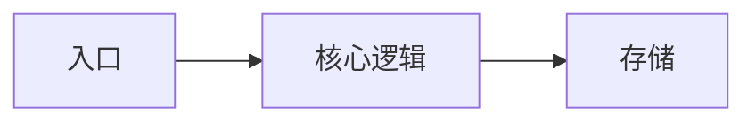

# 标题

## 背景与问题

要解决什么问题？为什么会现在做？

## 目标与非目标

- 目标：
- 非目标（明确不做什么，避免范围蔓延）：

## 方案

## 关键取舍

| 选项 | 优点 | 代价 | 结论 |
| --- | --- | --- | --- |
| 方案 A |  |  |  |
| 方案 B |  |  |  |

## 影响面

- 数据：
- 接口：
- 兼容性：

## 风险

| 风险 | 影响 | 缓解措施 |
| --- | --- | --- |
|  |  |  |

## 待定问题

- [ ] 

## 变更记录

| 日期 | 变更 | 作者 |
| --- | --- | --- |
|  |  |  |
